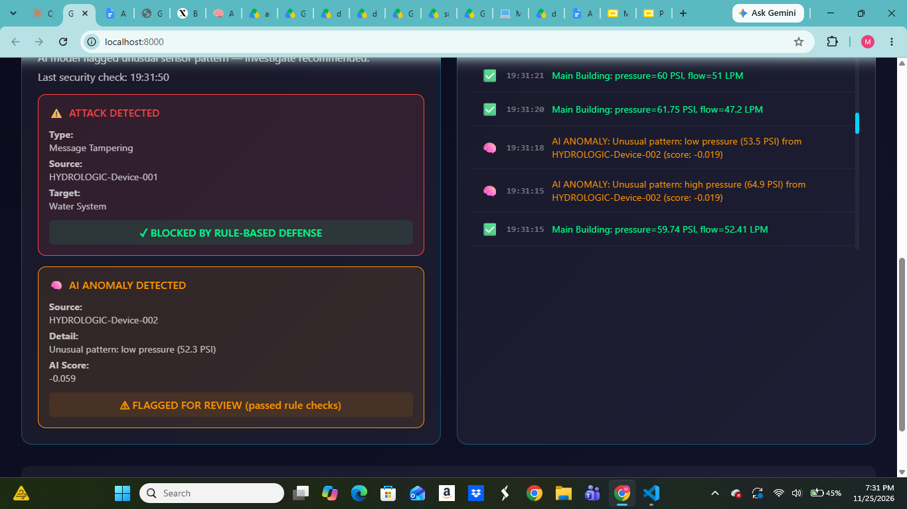
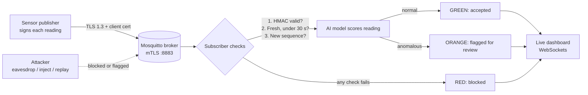
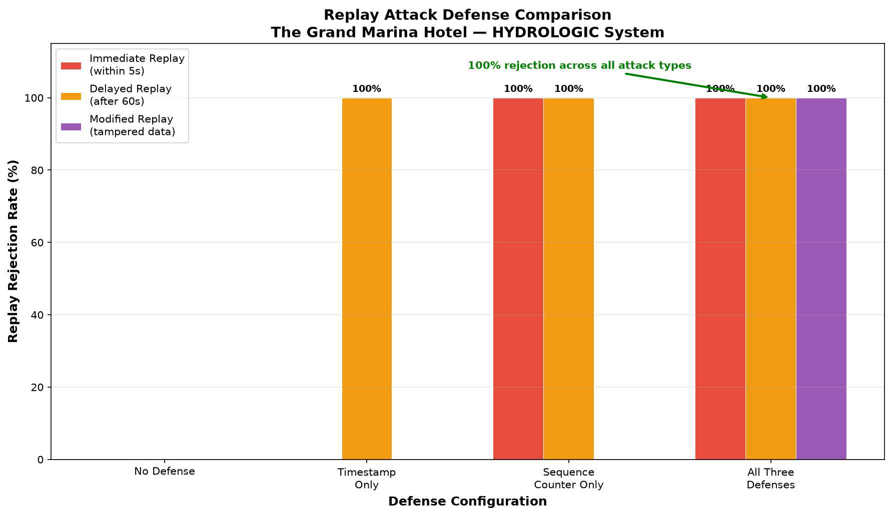
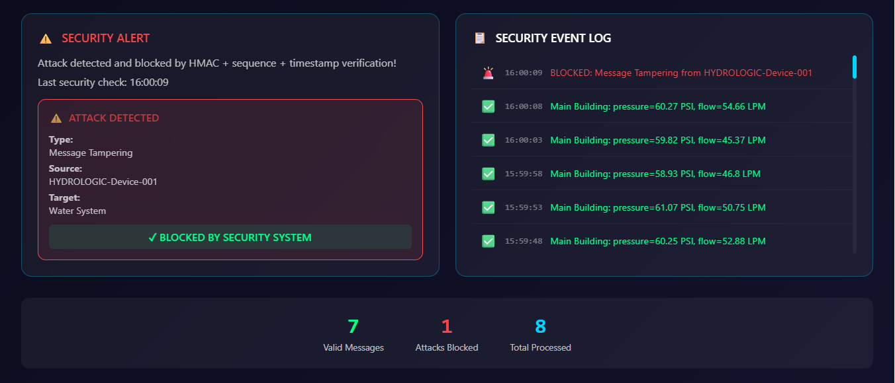
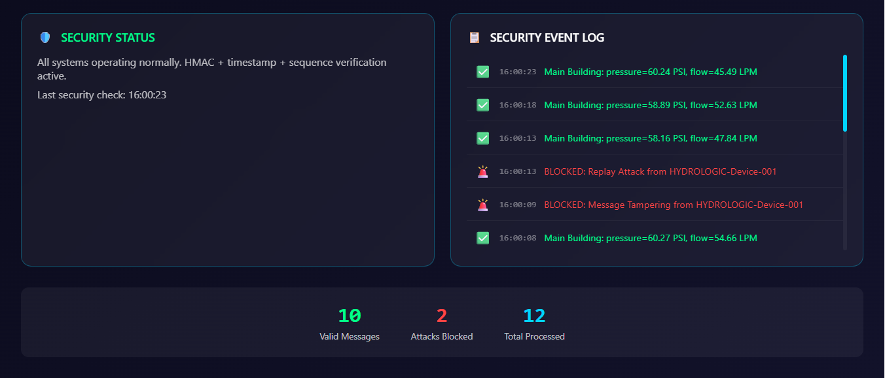
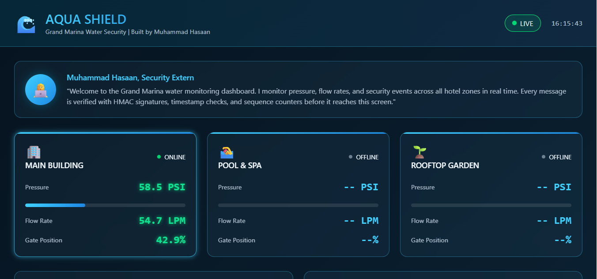

# IoT Water-System Security Lab: Attack, Defend, Detect

**I attacked a simulated hotel water-monitoring system, then secured it layer by layer: encryption, device identity, message signing, replay defense, a live security dashboard, and an AI model that flags what the rules miss.**

Built during my **IoT Cyber Defense externship with Extern** (Hydroficient project, Oct.–Nov. 2026). Python · MQTT (Mosquitto) · TLS 1.3 / mTLS · HMAC-SHA256 · scikit-learn



> All data is synthetic. Certificates, private keys and secrets are **not** included; generate your own to run it.

---

## Results at a glance

| Layer | What I tested | Result |
|---|---|---|
| Baseline (no security) | Eavesdropping and fake-data injection | An eavesdropper read **100%** of traffic (3,000+ messages) in plain text; forged readings were accepted as real |
| TLS 1.3 encryption | Unencrypted clients, latency, load | Unencrypted clients rejected; **+0.25 ms** latency (0.5%); **0 errors** at 100 msg/s |
| Mutual TLS (device certificates) | Missing, wrong-CA and expired certificates | **4/4** identity tests passed |
| Replay defense (HMAC + timestamp + sequence) | 12 experiments: 4 defense setups × 3 replay types | Only all three layers together blocked **100%** of immediate, delayed and tampered replays |
| Live security dashboard | Injection and replay during live traffic | **2/2** attacks blocked; found a restart flaw causing **30** false alarms |
| AI anomaly detection (Isolation Forest) | 13-configuration tuning sweep; compared with LOF and One-Class SVM | False alarms cut from **14 to 0** (precision 0.74 → 1.00, F1 0.78) |
| Rules + AI, live | Attack simulator and anomaly injector running at once | Rules blocked **2** attacks; AI flagged **40** signed, valid-looking readings |

## Architecture



**Design choice:** rules run first and *block*, because a failed signature is certain. The AI runs second and only *flags*, because a model's score is a probability and blocking real data on a guess would be worse than a warning.

## Key findings

1. **No single defense is enough.** Timestamp-only checks missed fast replays; counter-only checks missed tampered ones. Only the combination blocked everything.
   
2. **Reliability is a security problem.** A normal publisher reboot reset its sequence counter, so the dashboard raised 30 false "replay attack" alarms in about 2.5 minutes and rejected real readings, while a zone card showed 3-minute-old data as ONLINE.
3. **Security cost almost nothing in speed.** TLS added 0.25 ms per message; mTLS added 2.5 ms per connection.
4. **AI catches what rules can't, but has blind spots too.** The model flagged signed, fresh readings like 69.9 PSI and 35.5 LPM that every rule passed. No model caught a stuck sensor, because each identical reading looks normal on its own, so a simple repeated-value rule should run alongside it.

## Screenshots

| Attack blocked in real time | Stats after the live attack test |
|---|---|
|  |  |

My customized "Aqua Shield" dashboard (branding, AI-assisted theme, custom high-pressure alert):



## Limitations
- Lab environment on one machine (localhost); not tested on a real hotel network or at full sensor scale.
- One shared HMAC key for all devices; a compromised device could sign fake data for others.
- No topic access-control lists or certificate revocation list yet.
- The AI model was trained on synthetic data and scores one reading at a time, so it can't see trends over time.

## Recommendations
1. Save sequence counters across device restarts.
2. Give each device its own HMAC key, add topic ACLs and a certificate revocation list.
3. Flag stale data on the dashboard and protect it with WSS and a login.
4. Add time-based checks (stuck values, slow drift) alongside the AI model.
5. Pilot on the real network before full rollout.

## Repo layout
```
project-04/   TLS encryption + security assessment
project-05/   Mutual TLS (device certificates) + identity attack tests
project-06/   Replay attack defenses + 12-experiment comparison
project-07/   Live security dashboard
project-08/   AI anomaly detection integrated into the dashboard
docs/         Screenshots and my final capstone presentation (PDF)
```

## Run it yourself
Requires Python 3, Mosquitto 2.x and `pip install paho-mqtt cryptography scikit-learn joblib websockets`.

1. Generate your own CA and device certificates: `python generate_client_certs.py` (none are included here).
2. Start the broker: `mosquitto -c mosquitto_mtls.conf`
3. Start the subscriber/dashboard: `python subscriber_dashboard_ai.py` (opens `http://localhost:8000`)
4. Start the sensor: `python publisher_defended.py`
5. Optional: `python anomaly_injector.py` (orange) and `python attack_simulator.py` (red)

The AI model file isn't committed; train and export it with the externship's Colab notebook, then place it where `subscriber_dashboard_ai.py` expects it.

## What I learned
- Read the logs before changing anything. A broker log line ("peer did not return a certificate") explained a test that looked like it passed but hadn't.
- Test your defenses by attacking them, and measure what gets through.
- Plan for normal failures like reboots, not just attackers. False alarms teach people to ignore real ones.

## Credits
Scenario, starter code and the anomaly-detection notebook were provided by Extern as part of the externship. The configuration, testing, experiments, analysis, dashboard customization and write-ups are my own work.

📄 Full write-up: [Capstone presentation (PDF)](docs/Capstone_Presentation.pdf)

**Muhammad Hasaan** · B.S. Information Systems, UMBC · CompTIA Security+ · ISC2 CC
